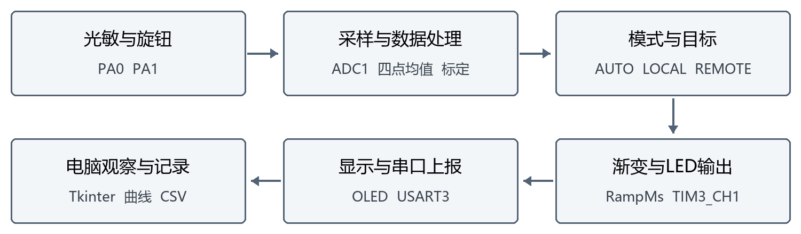

# STM32 光照监测与自动调光系统

基于STM32F103C8的学习项目，支持光照采集、三种来源调光、PWM渐变、Flash参数保存，以及Python串口上位机的实时曲线和CSV记录。

当前组合：固件V1.8 + 上位机V0.2。已完成本轮实物功能验收。项目按环境相对明暗映射补光，不是恒照度PID闭环。

维护账号：[00carmen](https://github.com/00carmen)。首次公开上传完成，[首轮自动测试](https://github.com/00carmen/stm32-light-controller/actions/runs/43236610960)的C和Python两项作业均通过；详见[上传结果](docs/上传结果.md)。

[版本记录](CHANGELOG.md) · [上传前剩余事项](docs/上传前剩余事项.md) · [首次Release草稿](docs/Release说明草稿.md)



## 功能

- ADC1依次采集光敏与电位器，光敏采用四点滑动平均和明暗参考标定。
- AUTO使用100减去相对光照，LOCAL使用旋钮，REMOTE使用电脑命令作为目标。
- TIM3_CH1输出1kHz PWM，默认每40ms变化一个百分点；实体按键支持本地接管。
- OLED显示状态，USART3通过文本行协议查询和控制。
- 暗参考、亮参考、渐变间隔支持Flash双页保存，带CRC、序号和最后提交。
- Tkinter上位机支持模式/参数操作、120秒曲线与CSV记录。

## 硬件与接线

使用STM32F103C8最小系统板、光敏AO模块、B5K电位器、OLED、普通LED与1kΩ电阻、按键、CH340模块、SWD下载器。模块型号与供电能力需匹配，不能把ADC输入接5V。

| 接口 | MCU端 | 接线 |
| --- | --- | --- |
| 光敏AO | PA0 | 光敏VCC=3.3V，DO不接 |
| 旋钮滑动端 | PA1 | 两固定端接3.3V和GND |
| LED | PA6 | PA6→1kΩ→LED正极，负极接GND |
| 按键 | PB1 | 按下接GND，内部上拉 |
| OLED SCL/SDA | PB8/PB9 | 软件I²C，电源3.3V，GND共地 |
| USART3 TX/RX | PB10/PB11 | 分别到CH340 RXD/TXD，共地，9600 8N1 |
| SWDIO/SWCLK | PA13/PA14 | 与下载器对应端连接并共地 |

详细电源、按键、面包板、SWD接线与复刻顺序见[硬件接线与复刻](docs/硬件接线与复刻.md)。

## 编译固件

1. 安装Keil MDK及Arm Compiler 6、STM32F1xx器件包和下载器驱动。原环境记录为AC6.24、Keil.STM32F1xx_DFP 2.4.1；换版本需重新确认兼容性。
2. 打开firmware/p7.uvprojx，确认目标为STM32F103C8。当前程序IROM大小为0xF800，末尾两页预留配置；不要改回0x10000覆盖保存区。
3. Build后用SWD下载，正常启动BOOT0为低。OLED显示V1.8和AUTO。重新烧录可能清除参数，保存验收使用复位或断电。

## 运行上位机

Windows安装含Tkinter的Python 3.10以上版本，当前使用Python 3.13验证。关闭占用串口的其他软件，双击software/pc_app/start.cmd。首次运行创建.venv并安装pySerial 3.5。保持启动日志窗口打开，可最小化。

在控制台选择实际COM口连接。进入REMOTE后才可发送远程亮度。曲线、CSV、参数操作详见[上位机说明](software/pc_app/README.md)。

## 文本协议示例

每条命令末尾需要CR或LF。上位机自动补CRLF。

```text
GET
CONFIG
MODE REMOTE
PWM 20
PWM 80
MODE AUTO
```

详细范围、错误与保存行为见[协议](docs/PROTOCOL.md)和[存储说明](docs/STORAGE.md)。

## 测试与实物记录

主机固件测试：安装GCC后，在仓库根目录用PowerShell执行`powershell -ExecutionPolicy Bypass -File tools/run_host_tests.ps1`。只对该脚本调用临时指定策略，不修改系统策略。输出为56项协议、20项配置、233项存储检查。

跨平台入口为`python tools/run_host_tests.py`，默认使用gcc，也可通过`--compiler`指定编译器路径。`.github/workflows/tests.yml`已配置C逻辑和Python含Tk界面的自动测试；首轮云端作业已验证通过，记录链接见上文。工作流不依赖开发板，不替代Keil目标构建和实物验收。

Python测试：在software/pc_app目录执行`.venv\Scripts\python.exe -m unittest -v`，需要可用的Tk显示环境；当前27项通过。测试不自动操作硬件。

examples/auto_light.csv是74行AUTO数据，examples/three_modes.csv是172行三模式数据；它们是实际采集记录，均未报告串口接收错误。持续运行和重连结果来自用户实物反馈。详见[验收记录与演示](docs/验收记录与演示.md)。

## 学习资料与目录

[Word学习手册](docs/STM32光照项目学习与复刻手册.docx) · [在线阅读版](docs/学习手册.md) · [GitHub发布说明](docs/GitHub发布说明.md)

```text
firmware/          固件及Keil工程
software/pc_app/    Python控制台与测试
tests/             不依赖开发板的C测试
tools/             运行测试的脚本
docs/              学习 接线 协议 存储与验收
examples/          实际采集CSV
```

## 实现边界与来源

当前是裸机主循环加中断；没有使用RTOS、DMA、ROS 2或PID。OLED为软件I²C，现有驱动不检查ACK。显示与串口发送为同步调用，周期是标称值。REMOTE断开电脑后保留最后有效目标，没有心跳超时自动切换，可按PB1回AUTO。传感器处理检测ADC超时，不保证识别所有断线。

基础学习参考江协科技的[STM32入门教程](https://www.bilibili.com/video/BV1th411z7sn)，作者确认LED、ADC、基础传输等部分参考或使用教程代码。系统应用、上位机、测试和文档在此基础上扩展，含辅助实现与整理。

第三方代码保留原版权声明，OLED/字库等逐文件出处仍需追溯，当前不声明整个仓库采用MIT。参见[来源记录](THIRD_PARTY_NOTICES.md)。
