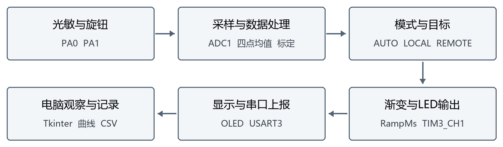

# STM32 光照监测与自动调光项目学习手册

适用版本  固件 p7 V1.8  上位机 V0.2

这份手册帮助你把已经运行成功的项目，变成能够自己复刻、修改和解释的项目。阅读时同时打开源码：先看输入与输出的关系，再理解采样、定时器、串口、存储和电脑界面如何协作。每章末尾的小练习都可以在当前工程的副本上完成，不要求一次全部掌握。

系统使用 STM32F103C8 采集光敏模块和旋钮，控制 LED，并通过 OLED 和 Python 上位机显示状态。已经完成三种模式、渐变调光、串口命令、参数掉电保存、实时曲线和 CSV 记录的本轮验收。它适合作为自动化专业向嵌入式软件和软硬件结合方向入门的完整练习。

## 阅读路线

| 你现在想做什么 | 阅读位置 |
| --- | --- |
| 拆线后重新搭建或让别人复刻 | 第2至4章和第16章 |
| 看懂 MCU 内部怎么工作 | 第5至13章 |
| 看懂电脑控制台怎么工作 | 第14至15章 |
| 遇到问题或需要证明结果 | 第17章 |
| 安排后续学习并练习讲解 | 第18章 |
| 准备把工程放到 GitHub | 第19章 |
| 查术语与官方资料 | 第20章 |

## 先分清这些概念

ADC 是模拟电压的数字表示；Light 是校准后的相对明暗百分比。Target 是希望达到的占空比；PWM 是当前已经设置到定时器的占空比。显示百分比并不等于测到了物理照度或 LED 的真实光功率。

AUTO 按环境明暗映射补光输出，尚未实现指定照度的 PID 闭环。当前固件是裸机主循环加中断调度，没有运行 FreeRTOS；OLED 使用软件 I²C，没有使用硬件 I²C 外设；ADC 没有使用 DMA。芯片支持某项功能，不代表当前项目已经使用它。

手册中的文件路径均相对于 p7 工程根目录。GitHub 准备版把固件放在 firmware，把上位机放在 software/pc_app，文件内部逻辑保持对应关系。


# 01 项目全貌与功能边界

## 一个系统中的两部分

开发板独立完成采集、控制、显示和参数保存；电脑负责观察数据、发送操作和保存测试记录。拔掉电脑串口连接后，开发板仍可工作。若当时处于 REMOTE，固件继续保持最后一个有效目标，可按实体按键回 AUTO。

| 功能层 | 当前实现 | 对应知识 |
| --- | --- | --- |
| 输入 | 光敏 AO、电位器滑动端、实体按键 | 分压、ADC、GPIO 上拉、消抖 |
| 数据处理 | 四点均值、明暗标定、限幅 | 环形数组、整数运算、参数校验 |
| 控制 | AUTO、LOCAL、REMOTE 和输出渐变 | 状态机、目标与实际值分离 |
| 输出 | PA6 硬件 PWM、OLED、串口状态 | 定时器、软件 I²C、文本协议 |
| 配置 | RAM 编辑、Flash 双页保存 | 非易失存储、CRC、写入提交 |
| 电脑端 | 控制、曲线、CSV | Python、线程、队列、事件循环 |

## 用一次操作串起全系统

在 AUTO 下遮住光敏电阻，模块 AO 电压升高，ADC 原始值增大。最近四次有效样本平均后，Light 下降；目标 Target=100-Light 因而升高。固件按设定速度增加实际 PWM，LED 逐渐变亮。OLED 更新本地状态，串口将同一组状态传给电脑，曲线与 CSV 再使用这些状态。

光敏模块电路决定“变亮时数值增大还是减小”。你这块已实测为变亮时 ADC 减小；换模块后必须重新确认，不能把这个方向当成所有传感器的通用规律。

## 完整与复杂的区别

这个项目的完整性体现在输入、处理、输出、交互、保存和验证相互衔接。它目前没有联网、手机端、云平台、ROS 2、视觉算法或电机闭环，简历和 GitHub 描述应围绕已经实现的内容。后续扩展时，一次只选一个技术目标。

动手验证：不看代码，用自己的话说明遮挡光敏后 ADC、Light、Target、PWM 四个量分别如何变化，并说明哪一个变化最慢。


# 02 器件清单与接口规划

## 复刻所需器件

| 器件 | 数量 | 复刻要求 |
| --- | --- | --- |
| STM32F103C8 最小系统板 | 1 | 当前工程按64KB Flash、20KB SRAM配置，通常配8MHz外部晶振 |
| 四针光敏电阻模块 | 1 | 有 AO 模拟输出；必须使用光敏模块，不能误用槽式红外模块 |
| B5K 电位器 | 1 | 三端，滑动端接 ADC；5kΩ为当前使用规格 |
| 四针 OLED 模块 | 1 | 与现有128×64驱动兼容，SCL/SDA接口，支持3.3V供电 |
| 普通 LED 与1kΩ电阻 | 各1 | 外接 LED，不依赖板载 LED 的引脚或有效电平 |
| 独立按键 | 1 | 按下导通的两端连接 PB1 与 GND |
| CH340 USB转TTL模块 | 1 | 串口逻辑电平与3.3V MCU兼容，不是RS-232电平转换器 |
| ST-Link 等 SWD 下载器 | 1 | 连接 SWDIO、SWCLK、GND，供电按下载器标识处理 |
| 面包板 杜邦线 USB线 | 若干 | 面包板电源轨可能中间断开，USB线必须可传数据 |

## MCU 资源分配

| 资源 | 当前用途 | 外部引脚 |
| --- | --- | --- |
| ADC1 通道0和通道1 | 光敏及旋钮依次单次转换 | PA0、PA1 |
| TIM3 通道1 | 1kHz LED PWM | PA6 |
| TIM2 更新中断 | 1ms系统节拍与按键扫描 | 不占外部定时器引脚 |
| GPIOB 输入 | 按键内部上拉，按下为低 | PB1 |
| GPIOB 开漏输出 | OLED 软件I²C | PB8、PB9 |
| USART3 默认映射 | 与电脑双向通信 | PB10、PB11 |
| SWD | 程序下载与调试 | PA13、PA14 |

规划引脚要同时检查“引脚的硬件功能”和“代码是否重新配置它”。PA1 已用于旋钮，不能再调用把 PA1 设置为输出的旧 LED_Init；PB11 已用于串口接收，不能再初始化占用它的旧 Key 模块。


# 03 完整接线表

先断电接线。A0、B10 等板上简称分别表示 PA0、PB10；它们不是芯片封装脚号。按模块丝印确认引脚，不能只按模块朝向或线的颜色判断。

| 器件端 | 连接目标 | 说明 |
| --- | --- | --- |
| 光敏 VCC | 开发板3.3V | 本复刻方案不接5V |
| 光敏 GND | 开发板GND | 与所有模块共地 |
| 光敏 AO | PA0 | ADC1通道0，模拟输入 |
| 光敏 DO | 不接 | 比较器数字输出，本项目不用 |
| 电位器中间滑动端 | PA1 | ADC1通道1 |
| 电位器两个固定端 | 分别接3.3V和GND | 交换两端只改变旋转方向 |
| LED 正极 | 通过1kΩ电阻接PA6 | PA6 → 电阻 → LED正极 |
| LED 负极 | GND | 通常短脚或外壳平边侧，必要时测量确认 |
| 按键一端 | PB1 | 内部上拉，松开高电平 |
| 按键另一端 | GND | 按下时PB1为低电平 |
| OLED VCC 和 GND | 3.3V 和 GND | 确认模块支持3.3V |
| OLED SCL | PB8 | 软件生成时钟 |
| OLED SDA | PB9 | 软件发送数据 |
| CH340 RXD | PB10 | 接收MCU的TX，必须交叉 |
| CH340 TXD | PB11 | 发送到MCU的RX，必须交叉 |
| CH340 GND | 开发板GND | 缺少共地可能无法可靠通信 |
| CH340 VCC | 使用独立板供电时不接 | 不把多个电源输出直接并接 |
| ST-Link SWDIO | PA13 或板上SWDIO | 数据线 |
| ST-Link SWCLK | PA14 或板上SWCLK | 时钟线 |
| ST-Link GND | 开发板GND | 下载器也需要共地 |
| ST-Link NRST | 可选接开发板NRST | 连接复位调试时使用 |

ST-Link 的3.3V端可能是输出，也可能是目标电压检测端，应按具体型号说明接线。优先沿用已验证的开发板供电方式；若下载器只提供电压检测，应接目标3.3V供检测，不能指望它给板供电。

四脚按键通常有两对内部常通脚，接错到同一对会一直导通。用万用表确认“松开断路、按下导通”的两端。面包板上电位器三脚、LED两脚不要落入同一组导通孔。


# 04 供电 面包板与下载接口

## 供电与电平

本项目传感器模拟输入限定在0至3.3V附近，参考电压按3.3V估算。ADC引脚的模拟输入不能因为“某些STM32数字脚耐5V”就接5V。USB转TTL模块的电源选择跳帽也不一定会同时改变TXD逻辑电平，应查模块说明或测量确认。[S1]

建议先给开发板正常供电，再由板上3.3V和GND为小信号模块供电。电源轨若中间断开，需要额外跳线连接。模块接地必须最终连接到开发板GND；仅连接到面包板上某条未接地的蓝色轨不算共地。

LED与光敏电阻尽量分开，避免LED直射光敏模块。否则LED改变输出后又改变传感器读数，观察到的光照曲线会夹带自身照射的影响。

## 编译与烧录

当前工程使用 Keil MDK、Arm Compiler 6，工程记录的编译器版本为6.24，器件包为Keil.STM32F1xx_DFP 2.4.1，目标芯片为STM32F103C8。换电脑需要安装可用的编译器、器件包和下载器驱动，再检查Target设置。

1. 打开 p7.uvprojx，确认Target器件、AC6和IncludePath正确。启动文件为 startup_stm32f10x_md.s。
2. 保持IROM起始地址0x08000000、大小0xF800，IRAM起始0x20000000、大小0x5000。末尾2KB Flash已经留给配置，不能改回64KB程序区。
3. 选择对应SWD下载器，执行Build，确认没有错误，再Download。正常从Flash启动时BOOT0保持低电平；下载后复位运行。
4. OLED应显示版本V1.8和AUTO，串口使用9600、8N1、无流控。电脑串口号以本机实际枚举为准，COM7只是当前机器的记录。

串口模块负责收发数据，SWD负责下载调试，两者是不同接口。当前流程不需要通过串口进入系统Bootloader烧录，也不需要为了正常运行把BOOT0置高。

## 接线复核顺序

断电检查电源和共地，再核对信号线，最后上电。若重新插线后LED和串口同时异常，先测供电和公共地，再检查面包板接触，不要立即同时修改多个驱动文件。


# 05 架构与源码阅读地图



## 从应用层往下读

先读 User/main.c 中的 AppState，再顺着 SampleInputs、UpdateTarget、MovePwmTowards、RenderStatus、ReportStatus 阅读。AppState把原始采集值、计算结果、模式、目标和当前输出放在一起，便于追踪一次状态更新。

| 文件或模块 | 负责什么 | 首先定位的入口 |
| --- | --- | --- |
| User/main.c | 初始化、模式和主循环 | main、SetMode、ExecuteCommand |
| Hardware/LightSensor.c | 两路ADC和四点滤波 | ReadAdcChannel、LightSensor_Filter |
| Hardware/LedPwm.c | TIM3 PWM | LedPwm_Init、LedPwm_SetDuty |
| Hardware/ModeKey.c | 按键消抖与事件计数 | ModeKey_Scan1ms、ModeKey_TakePress |
| Hardware/Serial.c | USART3、接收环形缓冲 | USART3_IRQHandler |
| Hardware/OLED.c | 软件I²C和字符显示 | OLED_I2C_SendByte、OLED_ShowNum |
| System/AppTick.c | 1ms系统时间 | TIM2_IRQHandler |
| System/CommandProtocol.c | 文本行与命令解析 | CommandProtocol_Feed |
| System/AppConfig.c | 校准、速度、范围检查 | AppConfig_LightPercent |
| System/ConfigStore.c | 双页记录、CRC与提交 | ConfigStore_Save、ConfigStore_Load |
| System/ConfigFlash.c | 芯片Flash受限访问 | ConfigFlash_ErasePage |

Library 是标准外设库；start 是启动、设备头文件与时钟支持。第一遍不用逐行阅读这些基础库。旧 LED、Key、CountSensor 文件是模板遗留，当前主程序不用；发布准备版会移除这些未用文件及工程引用。

练习：在main.c里标出“输入”“计算”“输出”“通信”四类调用，找出哪两类仍然可能阻塞主循环。


# 06 用到的 C 语言与时钟基础

## C 语言知识要落在代码上

uint8_t、uint16_t、uint32_t让数据宽度明确。ADC用16位容纳0至4095；累计和、乘法中间值和系统时间用32位，避免小整数运算溢出。把变量存成16位，并不代表所有运算都能安全地用16位完成。

struct将关联状态组合，enum让AUTO等模式名称代替随意的数字。指针参数如LightSensor_Read(&app.rawLight)允许函数写回结果；返回值另外表示成功或失败，防止把采集失败误认为有效0。

static用于限制文件内变量和函数的可见范围，也用于保留函数调用之间的状态。volatile提醒编译器某些值会被中断或硬件改变，但它不是线程锁，也不能自动保证一串读改写操作不会被打断。

## 时钟链路

start/system_stm32f10x.c 当前选择72MHz系统时钟；常见板载外部晶振为8MHz，经PLL倍频。系统时钟、外设总线时钟、定时器时钟和ADC时钟不是同一个概念。当前PCLK1通常为36MHz，PCLK2为72MHz；APB1分频不为1时，对应定时器时钟为PCLK1的两倍。

因此TIM2、TIM3按72MHz定时器时钟工作，而不是直接按36MHz算。LedPwm_Init和AppTick_Init会读取时钟并处理倍频规则。ADC时钟使用PCLK2除6，即12MHz。改系统时钟后，应重新核对所有依赖时钟的模块。

## 库函数不是另一种硬件

RCC_APB2PeriphClockCmd是打开外设时钟；GPIO_Init是配置引脚；TIM_TimeBaseInit是配置定时器。标准外设库将寄存器访问包装成函数。本项目使用StdPeriph，不是HAL；迁移HAL时原理可沿用，但接口和初始化方法不同。

练习：解释为什么没有开启GPIOB时钟，调用GPIO_Init也不能按预期工作；解释GPIO_Mode_AIN与GPIO_Mode_AF_PP分别用于哪些当前引脚。


# 07 ADC采样与传感器含义

## 从电压到数字

ADC把输入电压量化为数字。当前ADC1为12位，因此有效结果范围0至4095。数值只表示相对于参考电压的比例；代码按VDDA=3300mV估算电压，没有实际测量每一刻的供电电压。

`估算电压 mV =AVG × 3300 ÷ 4095`

例如AVG=2048时，估算电压约1650mV。这个值不应写成精密电压测量结果，供电、模块和ADC误差都会影响它。

## 当前采样方式

PA0接ADC1通道0，PA1接通道1。代码关闭扫描和连续转换，每次调用先选通道、清EOC标志，再软件启动一次转换，等待完成后读取结果。两路共用ADC1，依次读取，不是两颗ADC同时采样，也没有DMA搬运。

```c
ADC_RegularChannelConfig(ADC1, channel, 1,
                         ADC_SampleTime_239Cycles5);
ADC_ClearFlag(ADC1, ADC_FLAG_EOC);
ADC_SoftwareStartConvCmd(ADC1, ENABLE);
```

初始化时执行ADC硬件校准；这与用明暗参考校准光照百分比是两件事。前者针对ADC硬件，后者定义当前传感器的应用刻度。

## 超时与失败状态

等待ADC完成有次数上限，避免硬件异常让主循环永远卡住。这里是循环次数限制，不是精确的毫秒超时。采样失败时相关状态标为ERR，光敏滤波窗口会清空。AUTO或LOCAL所依赖的输入无效时，输出置0；REMOTE不直接依赖传感器来生成目标。

ADC成功得到某个值并不证明传感器接线完整：悬空、短路或超出有效场景，也可能读到合法数字。当前实现检测转换超时，未实现可靠的传感器断线识别。

练习：只移动旋钮时，Pot/Knob应变化，ADC/AVG不应大幅同步变化；若同步变化，先检查供电、地线、接触和引脚是否接错。


# 08 滤波 标定与整数计算

## 四点滑动平均

光敏读数会有波动。LightSensor_Filter维护4个样本、总和、写入位置和有效样本数。每来一个新样本，减去被替换的旧样本，加上新样本，再计算均值。这样每次不用重新遍历整个窗口。

```c
lightSum -= lightSamples[lightIndex];
lightSamples[lightIndex] = value;
lightSum += value;
lightIndex = (lightIndex + 1U) % LIGHT_FILTER_SIZE;
```

假设已有1000、1020、980、1000，均值为1000；新样本1100替换最早的1000，均值变为1025。启动时只有几个样本就除以几个，避免把未填入的0算进去。均值计算加入除数一半，用整数实现近似四舍五入。

标称每50ms采一次，四点窗口跨越约150ms的首末采样间隔，新阶跃输入通常需要几个采样周期才完全进入窗口。滤波让曲线平稳，也引入响应延迟；它不能去除持续偏差，更不能把相对明暗变成lux。

## 明暗参考与限幅

当前默认暗参考3764、亮参考481，来自之前实际采样。对于当前“越亮ADC越小”的模块，按下面关系换算，再四舍五入并限幅到0至100。

`相对光照百分比 =暗参考减去 AVG 后乘以 100 ÷ 暗参考减去亮参考`

AVG接近3764时Light约0%；接近481时约100%；处于中间附近时约50%。如果AVG超过暗参考，直接取0；低于亮参考，直接取100。校准要求亮参考小于暗参考，跨度至少100，避免除0及过窄范围放大抖动。

换光敏模块、换摆放位置或改变演示光源后，可以重新采集稳定的明暗参考，再发CAL。不要沿用3764和481并宣称适配所有模块。

练习：用纸笔算AVG=2123时的Light，和tests/test_app_config.c的断言对照；再解释为什么用uint32_t保存乘100的中间结果。


# 09 PWM与平滑调光

## 两个参数各管什么

PWM用固定周期内高电平持续时间的比例控制输出。频率决定周期有多短，占空比决定高电平比例。本项目PA6使用TIM3_CH1，PWM频率为1kHz，占空比为0至100%。GPIO不是给LED输出连续可调的模拟电压。

`PWM 频率 =定时器输入时钟 ÷ 预分频系数乘以计数周期`

这里预分频系数是PSC+1，计数周期是ARR+1。当前定时器时钟72MHz，PSC=71先得到1MHz计数，ARR=999再得到1kHz PWM。

```c
/* ARR + 1 = 1000 */
TIM_SetCompare1(TIM3, (uint16_t)percent * 10U);
```

20%时CCR1=200，80%时CCR1=800，100%时CCR1=1000。由于计数器只从0数到999，CCR设1000可得到持续高电平。0%时CCR为0，持续低电平。

## Target与PWM分离

Target是控制逻辑算出的目标，output是实际设置到PWM的当前值。MovePwmTowards根据允许的变化步数向目标靠近，并限制不能越过目标。默认每40ms最多变化1个百分点；从20%到80%相差60个百分点，理想渐变时间约2.4秒。

RAMP设置的是毫秒每百分点，范围10至200。数值越大，变化越慢；它不改变1kHz的PWM载波频率。调RAMP和调PWM频率是两个不同操作。

PWM由定时器硬件持续产生，主循环负责更新占空比。OLED显示或串口同步发送时，PWM波形仍持续运行，但新的占空比更新可能延迟。主循环按已经过去的时间计算可推进的步数，避免简单“每循环加1”导致速度随负载改变。

练习：不改频率，只把RAMP改100，在REMOTE下从20%切到80%，预计约6秒。测试后恢复40；先不要SAVE，区分临时修改与持久保存。


# 10 节拍 中断与按键消抖

## 主循环如何安排多个任务

TIM2每1ms触发一次更新中断，累加毫秒计数，并执行一次按键扫描。主循环通过时间差判断是否需要采样、显示、上报和推进渐变，不用一串Delay_ms把所有任务串成固定等待。

| 任务 | 标称时机 | 执行位置 |
| --- | --- | --- |
| 系统时间和按键扫描 | 每1ms | TIM2中断 |
| 两路ADC采样 | 每50ms | 主循环 |
| OLED显示 | 每200ms，模式变化也更新 | 主循环 |
| 周期串口状态 | 每500ms，开启STREAM时 | 主循环 |
| PWM推进 | 按RampMs计算已过步数 | 主循环 |

```c
if ((uint32_t)(now - lastSample) >= SAMPLE_PERIOD_MS) {
    lastSample = now;
    SampleInputs();
}
```

无符号时间差允许计数器正常回绕时继续比较，前提是任务检查间隔远小于完整计数周期。32位毫秒计数约49.7天回绕一次；不用看到now小于上次值就直接认定异常。

## 按键为什么不能只读一次

机械触点在一次按下和释放过程中可能快速反复通断。ModeKey要求候选电平连续稳定约20ms，才更新稳定状态；只在稳定“按下沿”产生事件，稳定释放不产生模式切换。按住不连发，启动时已经按住也不会凭空产生一次按下事件。

中断只增加produced计数，主循环推进consumed计数取出事件。中断与主循环分开写各自计数，避免“读到标志后清零”丢掉恰好到来的新事件。

中断要短：不在里面刷OLED、等待按键释放、解析文本或写Flash。当前调度也不是严格硬实时，主循环里的OLED和串口发送仍是同步调用。

练习：按住按键3秒，检查只切换一次，同时曲线继续更新；松开后再次按下，才允许下一次切换。


# 11 模式状态机与OLED

## 三种控制来源

| 模式 | 目标来源 | 其他输入的作用 |
| --- | --- | --- |
| AUTO | 100减去相对光照 | 旋钮仍采集和显示，但不决定目标 |
| LOCAL | 旋钮百分比 | 光照仍采集和显示，但不决定目标 |
| REMOTE | 最近有效的远程PWM目标 | 旋钮和光照不决定目标 |

SetMode统一处理模式变化。每次从其他模式进入REMOTE，remoteTarget先取当前output，避免刚进入遥控就使用一个旧值。然后PWM命令才将remoteTarget改成指定值。实体按键在AUTO与LOCAL之间切换，在REMOTE中直接回AUTO。

模式切换后Target可以立即改变，实际PWM继续渐变。断开上位机并不等于退出REMOTE；目前没有心跳超时自动接管逻辑。按实体按键可以回AUTO，上电或复位也从AUTO启动。

## OLED的四行

| 显示 | 含义 | 出错时 |
| --- | --- | --- |
| MODE 和 V1.8 | 当前模式和固件版本 | 版本用于核对下载对象 |
| R 和 A | 光敏原始值与四点均值 | ERR或横线 |
| L 和 T | 相对光照与目标占空比 | 无效光照显示横线 |
| P 和 PWM | 旋钮百分比与当前输出 | 无效旋钮显示横线 |

OLED.c用PB8/PB9开漏输出软件模拟I²C时序。代码发送0x78作为带写位的地址字节，对应7位设备地址0x3C；0x00表示后面是命令，0x40表示后面是显示数据。不同模块控制器或地址不兼容时，不能只换插头就保证可用。

当前OLED驱动额外发第九个时钟，但不检查ACK，也没有完善的总线故障反馈。屏幕已经实测可用，但不能把它描述为具备I²C错误检测的通用驱动。开漏输出依靠上拉回到高电平，模块需有合适上拉；上拉电平也应兼容3.3V。

练习：解释为什么屏幕的T已经80而PWM仍35时不是显示错误；找到RenderStatus中两者分别读取哪个成员。


# 12 串口硬件与文本协议

## 字节和命令不是一回事

USART3使用PB10发送、PB11接收，9600波特率、8位数据、无校验、1位停止位。8N1下每字节通常需要10位线路时间，9600波特约等于每秒960字节。状态行有一百多字节，同步发送会占用可观的主循环时间。

HEX模式输入41会发送一个0x41字节，ASCII含义是A；文本模式输入41会发字符4和1，即0x34、0x31。早期回显实验可以只收发一个字节，当前项目需要完整文本行，如GET加CRLF。没有换行的STREAM OFF不是一条完整命令。

## 中断收字节 主循环解命令

USART3_IRQHandler读取字节，放入256位置的环形缓冲，保留一个空位区分空和满，所以可用容量255字节。主循环每轮最多取32字节，交给CommandProtocol_Feed拼行和解析，防止串口处理无限占据一次循环。

行最长63字符，接受CR、LF或CRLF，命令不区分大小写。部分命令空闲约1秒仍未换行，会报ERR INCOMPLETE_NEED_NEWLINE并丢弃。溢出或串口错误后丢弃排队字节及残行，要求重发完整行，避免执行被截断的参数。

| 命令 | 作用 | 需要注意 |
| --- | --- | --- |
| GET 和 CONFIG | 查状态和参数 | STREAM OFF后仍可查询 |
| MODE AUTO/LOCAL/REMOTE | 切换模式 | 必须确认回复 |
| PWM 20 | 设置远程目标 | 仅REMOTE有效，范围0至100 |
| STREAM ON/OFF | 开关周期状态 | 不关闭串口，也不屏蔽按键事件 |
| CAL 3764 481 | 设置暗参考和亮参考 | 暗在前、亮在后，先校验再修改 |
| RAMP 40 | 设置渐变速度 | 范围10至200ms每百分点 |
| DEFAULTS | 恢复RAM默认参数 | 不自动保存 |
| SAVE 和 LOAD | 保存和载入Flash参数 | 模式、远程目标、STREAM不保存 |

成功以OK开头，错误以ERR开头，状态以STATUS开头，按键事件以EVENT开头。协议层负责识别内容，应用层负责判定当前状态是否允许执行。


# 13 参数保存与Flash可靠性

## RAM和Flash解决不同问题

CAL、RAMP、DEFAULTS先修改RAM，断电会丢失。SAVE才写Flash；LOAD恢复最新有效Flash记录。Saved表示有可用保存记录，Dirty表示当前RAM配置与保存值不同；这两个状态可以同时为1。

当前64KB芯片的末尾两页作为配置区：A页0x0800F800，B页0x0800FC00，每页1KB；程序区大小限制为0xF800，即62KB。这里使用固定受限地址，不应照搬到另一款芯片或不匹配的链接布局。

## 为什么要两页和最后提交

Flash通常不能像RAM一样随意覆盖写，写入前需要擦除，擦除会影响整页。ConfigStore每次选择另一页写新记录，保留上一页有效记录。先写版本、长度、序号、参数和CRC，读回核对，再最后写magic提交标记。

| 24字节记录内容 | 大小 | 作用 |
| --- | --- | --- |
| magic | 4字节 | 识别已经提交的记录，最后写 |
| 版本与记录长度 | 各2字节 | 拒绝不兼容格式 |
| sequence | 4字节 | 选择较新的有效记录 |
| dark、bright、rampMs、保留项 | 各2字节 | 配置与格式预留 |
| CRC32 | 4字节 | 校验前面版本至保留项的16字节 |

如果新记录写到一半失败，旧有效页仍在；加载时会检查标记、CRC、范围和序号，再选有效记录。CRC用于发现损坏，不是加密或身份验证。序列化采用明确的小端读写函数，不直接把可能有填充的C结构体原样写入Flash。

## 减少写入与测试边界

重复保存相同配置返回OK SAVE UNCHANGED，不额外擦写。当前没有按周期频繁保存参数，也不是完整的磨损均衡系统。Flash操作可能短暂停顿，不在SAVE期间连续灌入命令。

已完成保存后复位、加载与相同配置跳过写入的实物验证；主机模拟还覆盖中断写入、CRC损坏和旧记录回退。模拟覆盖不等于对所有电源跌落情形完成了真实断电压力测试。重新Download可能擦掉参数，验证掉电恢复时用复位或断电，不用再次烧录替代。


# 14 Python上位机的结构

## 主线程负责界面 后台线程负责串口

如果在Tk回调中一直等待串口数据，界面就可能卡住。当前SerialSession线程持有串口，主线程通过队列发命令、取事件，并用root.after每50ms处理消息。后台线程不直接更新Tk控件。[S3][S4]

| 模块 | 职责 | 阅读重点 |
| --- | --- | --- |
| app.py | 页面、按钮状态、连接与回调 | handle_line、poll_events |
| transport.py | 串口线程、排队、回复与超时 | SerialSession.run、send_many |
| protocol.py | 字节拼行、字段与范围验证 | LineFramer、parse_line、wire_command |
| capture.py | 有界历史与CSV文件 | TelemetryHistory、CSVRecorder |
| trend_view.py | Canvas曲线、坐标和缺失断线 | segments、redraw |

连接成功只是串口句柄打开，收到设备回复才表明通信链路在工作。连接后依次请求STREAM ON、GET、CONFIG，不自动改变校准、亮度或保存Flash。

## 命令排队与回复确认

一次只等待一条命令的匹配回复，队列上限32。参数应用把CAL、RAMP、CONFIG整批检查容量后排入队列。某条命令被拒绝或超时后取消后续排队操作，不自动重发SAVE，避免不清楚设备状态时反复写入。

在UI拖动亮度滑块只修改待发送值，点击发送才执行命令。只有确认处于REMOTE，远程发送控件才启用；实际输出始终由设备STATUS更新，不把滑块位置当成已执行结果。

## 部分成功不是整批回滚

CAL成功后，RAMP可能失败，当前协议没有事务回滚。此时应重新CONFIG核对，不假设全部操作都没发生。协议也没有请求ID，周期STATUS与GET回复不能被严格区分；当前按类型和关键字段匹配，后续可通过请求编号改进。

练习：找到timeout事件的处理，解释为什么“串口已打开但设备无回复”和“串口根本没打开”需要不同提示。


# 15 实时曲线与CSV数据

## 同一条有效状态的两个去向

parse_line通过字段检查后，STATUS一方面更新上方数值，另一方面加入曲线历史；如果正在记录，也写入CSV。重绘不会生成采样点，旧值不会被定时器反复当成新数据保存。

曲线展示最近120秒，内存最多1200点。Light蓝线表示相对光照，Target橙色虚线表示目标，PWM绿线表示当前输出。相同数值会重合；超过2秒没有连续状态则断线，无效传感器字段留空，不伪造为0。

## 时间和文件生命周期

串口事件带电脑接收时间和单调时钟。time_iso用于知道何时收到数据，含本机时区；elapsed_s用于计算从开始记录经过了多久，不受系统时间调整影响。这都不是MCU精确采样时间。

开始CSV后发送STREAM ON，默认文件位于records文件夹；只记录开始之后收到的新状态。停止、断开或关闭应用时关闭文件；约每1秒刷新缓冲，正常停止完成最后刷新。清空曲线不清空文件，重连清空历史但不自动开始新文件。

| 字段组 | 主要内容 | 怎么使用 |
| --- | --- | --- |
| 时间 | time_iso、elapsed_s | 查看过程与间隔 |
| 传感器 | adc_raw、adc_avg、voltage_mV、light_percent | 比较原始波动与滤波效果 |
| 控制 | mode、target_percent、pwm_percent | 判断模式与渐变 |
| 旋钮及远程 | pot_raw、knob_percent、remote_percent | 判断目标来源是否正确 |
| 错误与配置 | rx_errors、cal_dark、cal_bright、ramp_ms | 给测试结果保留条件 |

CSV使用UTF-8 BOM，便于Excel或WPS读取。传感器ERR字段留空；配置变化后到新CONFIG确认前，参数快照也留空。保存路径与行数显示在页面下方，出现写入失败会提示并停止记录。

练习：在三模式示例CSV中分别筛选AUTO、LOCAL、REMOTE，验证Target来自哪列，再找出Target已改变但PWM还在过渡的行。


# 16 从零复刻的执行顺序

## 先让最小链路正常

1. 准备STM32F103C8板、SWD下载器、兼容的OLED和供电。按第3章接线，检查BOOT0与供电后编译、下载当前工程。确认OLED显示V1.8和AUTO。
2. 接光敏模块AO到PA0。观察R/A变化：当前模块照亮时数字下降，遮挡时上升。若方向或范围不同，先核对模块类型、AO与DO，再重新标定。
3. 接PA6外部LED，接PA1电位器和PB1按键。AUTO检查遮挡后LED渐亮；LOCAL检查旋钮；按键检查一次按下只切换一次。
4. 接CH340并共地，PB10到RXD、PB11到TXD。关闭其他串口软件，在上位机里选择实际端口连接。若先用串口助手，设置文本收发并确保命令有实际CR或LF。

## 再验证交互与保存

5. 依次发送GET、CONFIG，等每条回复。进入REMOTE，发送PWM 20，再发送PWM 80，确认目标和实际输出不同步跳变，而是逐渐靠近。
6. 测PWM 150、AUTO下PWM 50、RAMP 0等非法操作，确认返回错误且原状态不被破坏。不要一开始就连续高速灌入大量命令。
7. 修改RAMP为100，应用后SAVE，等待确认，再按复位或正常断电重启。CONFIG应仍是100；之后DEFAULTS并SAVE恢复默认。无额外需要时不反复重复写Flash。
8. 开启CSV记录，分别演示AUTO、LOCAL、REMOTE，再停止检查。运行约5分钟，检查界面响应；记录中断开，再重连，核对停止保存、状态恢复、曲线重置。

## 每一步都留下可核对的结果

硬件照片、完整接线表、编译日志、软件测试输出、两份实际CSV与演示说明，比单独一张“成功了”的截图更便于复刻。自己的复刻记录可以写清模块型号、板卡版本、校准条件和遇到的问题。

当前已完成上述本轮功能验收。实际证据包括74行AUTO数据、172行三模式数据和用户对持续运行及重连的确认。不要把一次约5分钟检查表述为长时间工业可靠性测试。


# 17 调试方法与已有测试

## 按链路定位 不同时改多处

| 现象 | 优先检查 | 下一步证据 |
| --- | --- | --- |
| OLED亮但串口无回复 | COM占用、交叉接线、共地、9600和换行 | GET完整行、通信记录、RxErr |
| 电脑有回显但OLED接收值不变 | 是否短接了模块自身TX/RX、是否真进入MCU | 拆除自环，验证MCU发出的独特状态 |
| 刚重连后LED和串口都异常 | 供电、面包板公共地、松线 | 测3.3V和地连续性，再查信号 |
| 光照方向反了或只有两档 | 模块类型、AO/DO是否接反 | 看原始ADC，不先修改百分比公式 |
| T已变化但PWM暂时不同 | 正常渐变、RampMs配置 | 连续观察几个状态点 |
| 串口报缺换行 | 发送方式与CR/LF | 文本命令末尾真实换行，不写字面反斜杠n |
| GUI双击闪退或依赖缺失 | 使用start.cmd，查看保留的启动窗口 | app_error.log、Python及Tk是否可用 |
| 复位后参数丢失 | 是否SAVE、是否重新烧录、CONFIG状态 | OK SAVE、Saved/Dirty/Seq |

## 哪些结果已经有证据

固件主机测试包含56项协议检查、20项配置检查和233项存储检查。配置测试含四组参数的全ADC范围扫描；存储测试使用模拟Flash，覆盖写入中断、CRC损坏、回退和序号回绕。Python端27项测试覆盖协议、模拟串口、控件状态、CSV生命周期和缺失曲线处理。

实物AUTO记录74行，约0.500秒一行，全部满足Target=100-Light。三模式记录172行，LOCAL 75行、REMOTE 78行、AUTO 19行，三类目标映射均正确，RxErr全部为0；远程20%和80%均有到达目标的记录。

软件测试适合检查边界和异常分支；实物测试适合验证接线、电平、驱动、LED效果和上位机协作。测试通过不说明所有边界都覆盖，记录结果时要说明测试对象和条件。

练习：选择一次此前遇到的故障，写下“现象、假设、只改变的一项、观察证据、结论”，避免把尚未证明的引脚损坏当成最终原因。


# 18 分层学习与独立讲解

## 第一层 先能不看提示讲清现象

掌握引脚表、三模式的目标来源、ADC与百分比、目标与实际PWM、RAM与Flash。合上手册画出系统输入到输出的路径，再现场做AUTO、LOCAL、REMOTE各一个演示。

通过标准：能解释为什么REMOTE下旋钮不控制LED，为什么上位机断开后板还在运行，为什么RAMP越大渐变越慢。

## 第二层 能顺着代码追踪状态

依次阅读main.c、LightSensor.c、LedPwm.c、AppTick.c、ModeKey.c，再阅读Serial.c和CommandProtocol.c。每读一个模块，在副本里修改一个小参数并预测结果，不同时改变采样、滤波和速度。

建议实验：把滤波窗口4改8，比较原始值与均值的波动和响应延迟；恢复后只改RAMP比较渐变时间。修改窗口时同时核对数组长度、循环和类型，不只改一个数字就默认安全。

通过标准：能指出某个数值在哪里采集、在哪里计算、在哪里显示和发送；能区分中断处理与主循环处理。

## 第三层 能完成一项小扩展并验证

偏嵌入式软件，可先把串口同步发送改成中断发送队列；偏数据采集，可学习定时器触发ADC与DMA；偏控制，可先补充真实被控量和目标，再考虑闭环算法。先在副本上做一项扩展，写清要改善什么、用什么数据判断有效。

不要为了堆关键词同时加入FreeRTOS、ROS 2和多个传感器。RTOS适合在你能解释当前任务及共享数据之后再迁移；ROS 2需要另一个明确的机器人或上层协作场景。

## 可以用来检验自己的问题

为什么选两路依次采样而不是DMA？为什么一个串口接收字节不能当成完整命令？为什么Flash要预留空间、双页和最后提交？为什么GUI收到OK才改变控件状态？为什么曲线重绘不能产生新CSV数据？

能回答到本项目的具体代码和测试条件，比单纯背“熟悉STM32、掌握串口”更有说服力。仍需查手册才能解释的部分，可以继续写为“学习并实现”，不用夸大成熟程度。


# 19 GitHub整理与发布方案

## 让别人能看懂并复刻

建议仓库名stm32-light-controller。首页先说明实际功能，再提供硬件接线、编译运行、上位机启动、协议、测试与限制。源码和资料放在清楚的目录中，避免直接上传整个Keil安装目录或整个个人工作区。

```text
stm32-light-controller/
  firmware/          # 当前固件及Keil工程
  software/pc_app/    # Python界面与测试
  docs/              # 学习手册 接线 协议 验收
  examples/          # 实际三模式CSV示例
  tools/             # 主机测试脚本
  README.md
  THIRD_PARTY_NOTICES.md
  .gitignore
```

提交源码、工程配置、requirements.txt和必要文档；排除.venv、__pycache__、Objects、Listings、个人uvoptx/uvguix、运行日志和默认records目录。示例数据单独放examples，避免把每次测试文件都堆进仓库。[S5][S6]

## 当前准备版的发布边界

本次准备本地发布目录，不会因为“考虑上传”就创建远程仓库或推送。你可以先审阅目录、仓库名称和可见性；确认后再完成GitHub账号认证与推送。私有仓库便于先整理，公开仓库便于作为作品展示，两者都需要先检查要上传的内容。

保留ST标准库和ARM CMSIS文件原有声明。OLED驱动、字库和教程模板的来源需要补充，不能把所有文件都标成自己原创。准备版不擅自添加覆盖整个仓库的MIT许可证；公开托管与开源授权是不同问题，许可证要结合自己拥有权利的部分和第三方条款确定。[S7]

## 本地提交与远程发布

先在准备版根目录执行git status和git diff --cached核对清单，再提交。Git用户身份可只配置当前仓库；邮箱可使用GitHub提供的noreply邮箱。远程仓库建议建为空仓库，避免初始化README造成历史冲突。

具体命令在GitHub发布说明.md中给出，地址和身份使用占位符。不要把访问令牌写进仓库文件、远程URL或截图；本地commit不会自动上传，git push才会发送到已配置远程仓库。


# 20 术语速查与参考资料

| 术语 | 在本项目里怎样理解 |
| --- | --- |
| GPIO | 可配置的数字输入输出引脚，模拟/复用模式需要专门配置 |
| ADC | 把模拟电压转换成数字，当前12位 |
| PWM | 固定周期内高电平占比可调的输出 |
| PSC ARR CCR | 定时器预分频、计数周期和比较值 |
| NVIC | Cortex-M中断控制，配置使能和优先级 |
| ISR | 中断服务程序，当前负责快速记时、收字节和扫描 |
| UART USART | 当前采用USART的异步串口方式通信 |
| I²C | 时钟线和数据线构成的总线，OLED当前软件模拟 |
| RAM Flash | 运行时易失数据与掉电后可保存的数据 |
| CRC | 发现记录损坏的校验，不用于加密 |
| 裸机与RTOS | 当前主循环加中断；RTOS是可选择的后续任务调度方式 |
| 队列与状态机 | 前者传递待处理数据，后者规定当前模式与允许操作 |

## 代码与已验收资料

本手册的实现讲解对应User、Hardware、System和pc_app内源码。协议细节见PROTOCOL.md；存储记录与故障恢复见STORAGE.md；实测依据见验收记录与演示.md。遇到解释与后续代码版本不同，以对应版本代码和新的测试记录为准。

## 官方资料

[S1] ST STM32F103x8 xB 数据手册。查芯片容量、供电、电气条件和引脚复用。
https://www.st.com/resource/en/datasheet/stm32f103c8.pdf

[S2] ST STM32F103 官方文档页。查RM0008参考手册中的RCC、GPIO、ADC、TIM、USART与Flash章节。
https://www.st.com/en/microcontrollers-microprocessors/stm32f103/documentation.html

[S3] Python 3.13 Tkinter 官方文档。查事件循环、after与线程模型。
https://docs.python.org/3.13/library/tkinter.html

[S4] pySerial 官方入门。查端口参数、超时、读写及关闭。
https://pyserial.readthedocs.io/en/latest/shortintro.html

[S5] GitHub 本地代码上传说明。[S6] GitHub 忽略文件说明。[S7] GitHub 仓库许可证说明。完整可点击链接同时列在准备版的GitHub发布说明.md中。

阅读顺序建议：先用当前源码理解一个模块，再查官方文档解释寄存器和约束，最后用一次小实验验证。遇到不懂的缩写，回到它在当前信号链中的作用，不必先把整本芯片手册读完。
